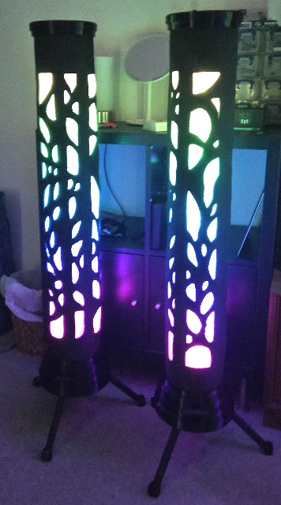

# Overview
BJC 2026 LED Space was created by the Flowception crew and I was the one who sorted the technical aspects of the space.

The plan was to make an LED space that we'd want to spin in, and we definitely achieved that.

The space had a series of DMX lights around the outside (to provide the background lighting), some LED columns (too add some fancy LED elements) and the LED "archways" that we didn't use as arches but instead used the to provide light directed into the space instead of just around.

## Components
- 5 x 3D printed LED columns
- 5 x LED archway
- An interactive projection that used a kinect as a 3d camera
- A bunch of other DMX lights
- Tree
- Lots of set dressing like vines

### How the LED worked
The LEDs were programmed using TouchDesigner, which is a piece of software that visual artists or or protection mappers use when they're creating live performances. The software itself is incredibly in-depth and I only used a very small part of its capability for this project but I was doing some pretty advanced things.

I had to build everything from scratch and that meant the control systems for the spotlights a way of switching between colour pallets a way of assigning effects to the archway and columns and a way of controlling it all without needing to have a computer open in front of you.

The various background lights we were using (LED bars, LED parcans and three Moving Heads) communicated over DMS so i needed to make a controller that would work with all of them in touch designer, which was a heavy project in of itself

The LED towers and arches were running WLED and were communicated to via WiFi

### Interactive Projection
The interactive elements of the space were projected onto a wall with a Kinect pointing at the space just infront.
Using the Kinect as an input to a bunch of Touch Designer

### LED Towers & Arches
The towers and arches ran off an ESP32 micro controller running WLED, which can take receive Art-Net instructions over WiFi

I have a detailed writeup of the LED towers [here](http://localhost:5173/personal/led-columns)

### Background Lights
The background lights were simply controlled by DMX which works by chaining all the lights together with one data cable

### Moving Heads
The original plan of with the moving heads was to make them track someone who was juggling LED balls in front of the camera. Unfortunately I ran into trouble with the LED balls being too bright for the camera and clipping out to white which made tracking an individual ball tricky.

In the end I decided to track an image of someone juggling different coloured balls instead.

<!--  -->

## The Computer Setup
Inputs
- Microsoft kinect, for video and depth data
- Buttons & fader controller, for changing colour pallets, projector effects and brightness of the LED components
- Knob controller, to change effect parameters and other things

The computer set up was pretty cool, I had a desktop PC running TouchDesigner with the controllers and the projector connected to it and then had a KV M connected to the same computer and all the wireless gear. I then remote into this KV M from another machine which effectively meant that there was a "backstage computer" that was running everything with a lightweight computer being used to act as the screen needed for any adjustment.

## Outcome
The project established a robust framework for future community events using scalable LED installations.
