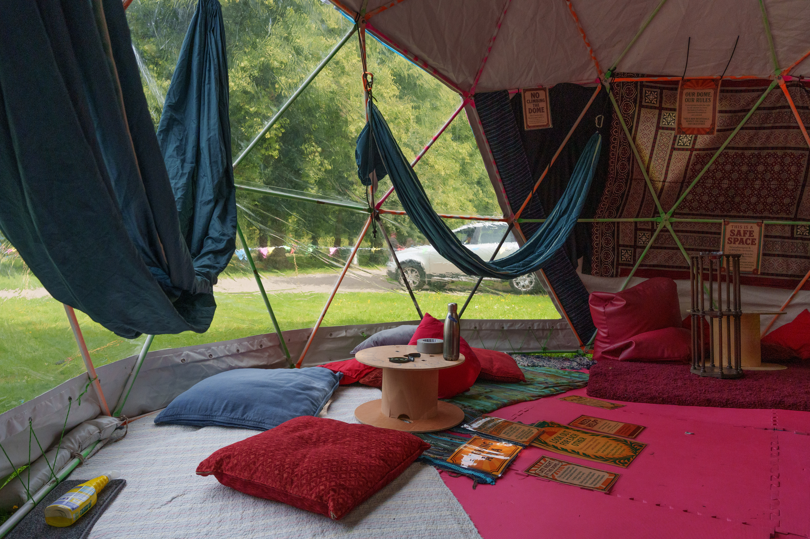
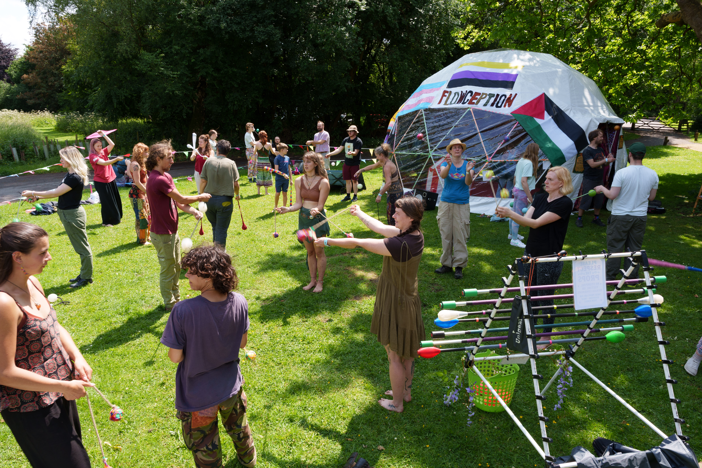

# Overview
The Dome is a space I, along with the other members of Flowception, took to slackfest to act as a chill / workshop space for everyone.

The idea was to have a workshop space out the front and a cosy inside to the dome that people can use to get away from the noise of the festival or just a place to be for a little while. It'd also act as some extra covered space in the event of rain.

Outside the dome also became a sort of LED space in the evenings due to the lights we had

