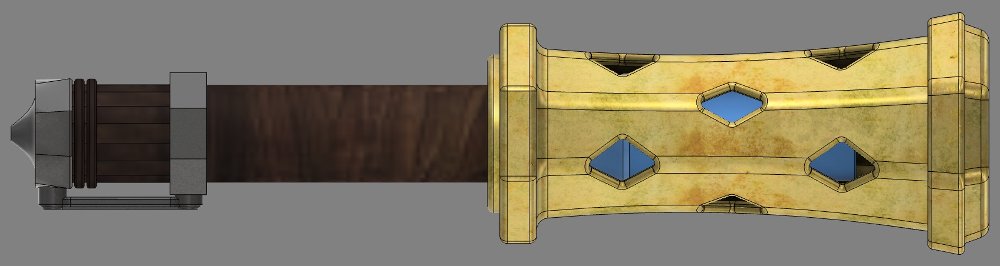
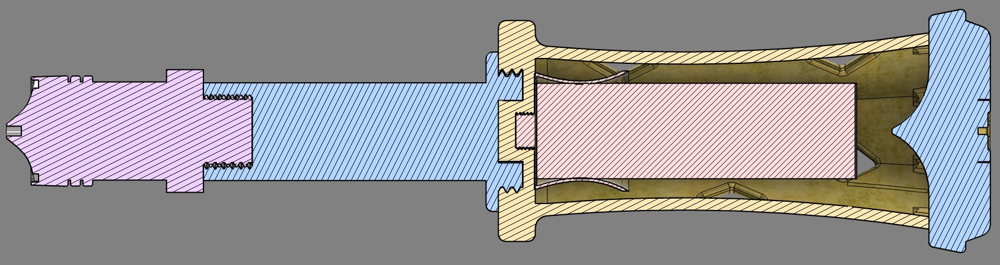

The tv show Arcane has some of my favourite art style in the architecture and the tech, so I decided to have a go at making something from the show. At the same time, I've wanted to mess about with smoke props for a while and Arcane has the perfect thing

There's a really emotional scene where one of the main characters sets off a blue smoke flare as a way to signal another main character. The flare itself looks really cool, with old dirty brass for the metal and wooden handle

My version is fully 3D printed apart from a metallic plate in the cap to help dissipate any heat generated (a lessen I learned from V1). The smoke grenade is held in place by a TPU sleeve that is itself held in place with magnets.

All the parts screw together because it'd be practically impossible to print the full thing in one go.

Below is my instagram post about this project
[Insta Link](https://www.instagram.com/p/DdW8ijICEsH/?img_index=1)
