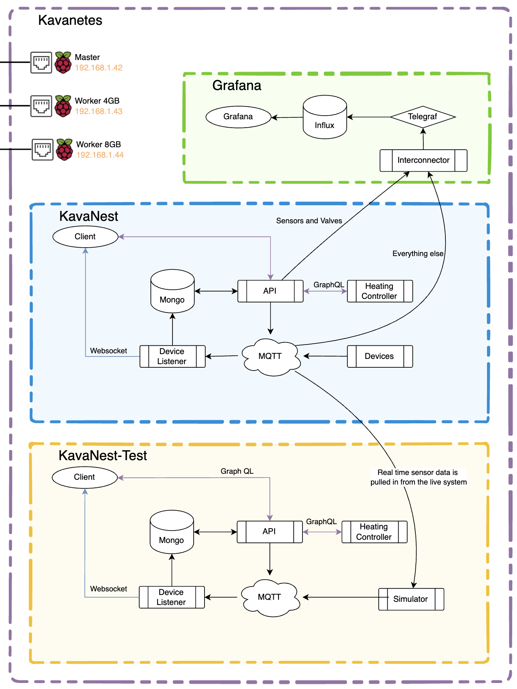
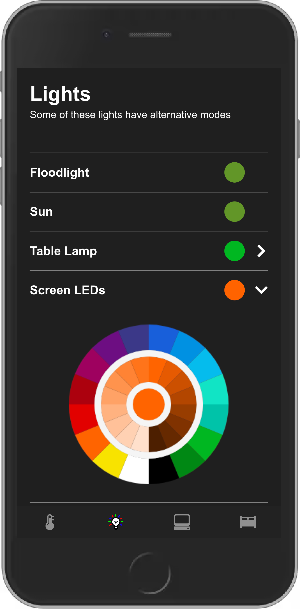
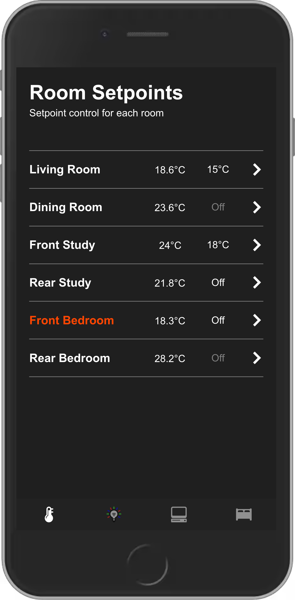
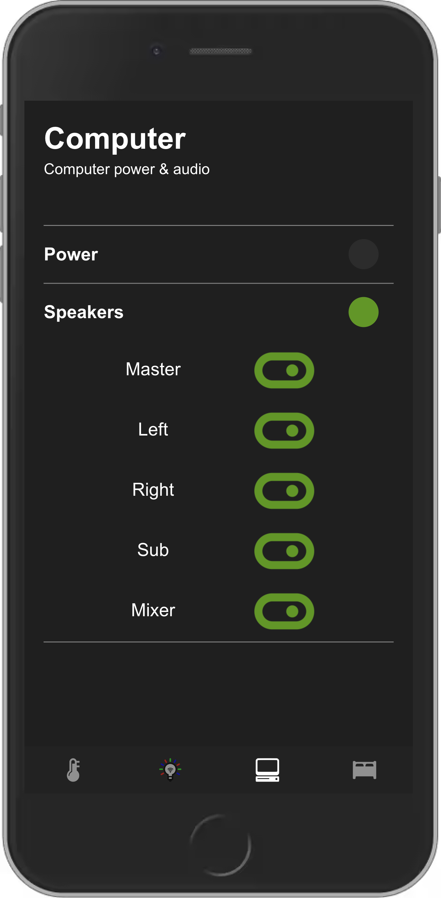
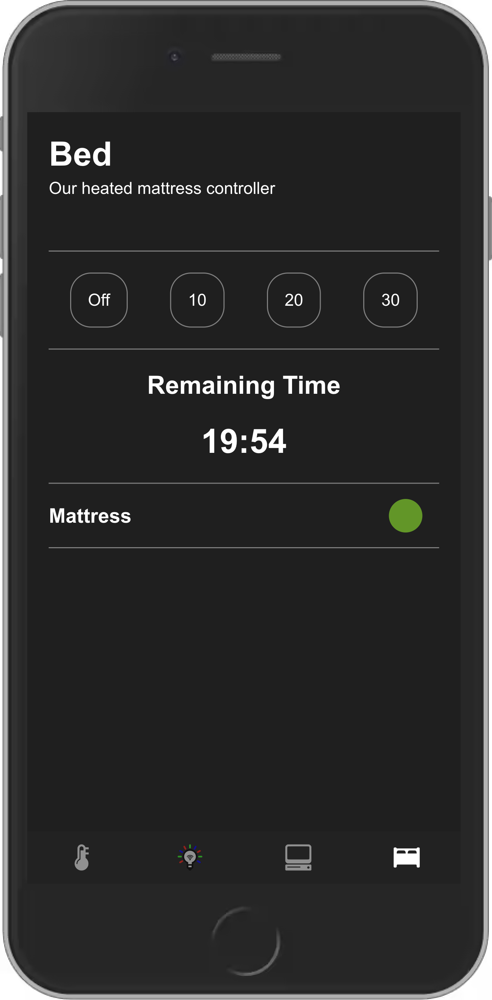
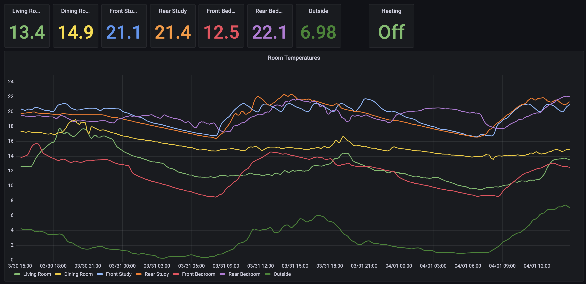

# Intro

---

The system, I’m calling KavaNest is a zone based heating system that controls my house. It allows me to control the temperature of each room independently, meaning I can heat just my office during the day and turn the heating on in the living room in the evening so it’s nice and warm for after work.

## The aim of the system

- Every room can be heated independently of the others
- A central place to control various lights around my house
- Act as a timer for my heated mattress in the winter
- Historical data viewable in Grafana
- A way to access my computer when I'm away from home
- All built and run internally to my home network, no phoning home to nasty companies that will sell your data

## How the system works

Each room has a temperature sensor and a thermostatic radiator valve which allows the system to monitor the temperature of the rooms and direct hot water to specific radiators independently of the others. A schedule controller looks at the desired temperature versus the actual temperature and activates the heating if it's needed. At this point, the boiler switches on, the radiator valves in there rooms that don't need heat all close, and the valve in the room that requires heat opens.

## The components of the system

- Physical devices like temperature sensors and radiator valves connect to my home wifi and communicate via MQTT.
- A Node.js app listens to the MQTT messages and updates a mongo store thats keeps track of the state of the system, this app also sends push messages to the client when something changes.
- A GraphQL API is used to interface with the system which reads and updates the data in the mongo store along with communicating with the physical devices via the MQTT network.
- Another Node.js app acts at the automation controller for the system. It uses the GraphQL API to read the current system state and update anything that needs changing like radiator valves.
- A React client app is used to interact with the system, which has been designed for mobile and desktop use. The client app mainly uses the GraphQL API, along with push messages that are sent to the client, via a web socket connection, every time something changes with the system.
- There is a Grafana dashboard that trends various data points like room temperatures and radiator valve states. This historical data has proven useful for optimising the system, and diagnosing issues if anything strange is happening. Prometheus is used to monitor the different Raspberry Pi’s in my cluster as well as some other devices all of which have their own status dashboard.
- Along side all of this is a test environment with a simulator that replicates the physical devices. This test environment is used when I want to try out new features, this way I won’t have to go without heating when I break something.
- The system is fully dockerized and is capable of being run on pretty much any platform. I have it running on my K3s cluster consisting of 3 Raspberry Pi 4Bs. Running things locally means that everything will work so long as the wifi signal is present, with no need for internet access and no company selling your data.

# The React app

---

[https://github.com/InvisiBug/kavanest-client](https://github.com/InvisiBug/kavanest-client)

I work as a fronted developer in my day to day so this app was a perfect way to try out the things that I’d picked up at my job.

The react app is the main way to interface with the system. It allows the user to set the heating schedule for each room, switch on / off or change the colour of various lights in the house and more. The app listens to push messages so any change in the system is instantly updated on all instances of the app.

# The API

---

[https://github.com/InvisiBug/kavanest-api](https://github.com/InvisiBug/kavanest-api)

I decided to use a GraphQL api for the system. Mostly because I needed practice with GraphQL for my job but also because it allows you to request only the data you need at that time without pulling and useless info at the same time.

The client, controller and grafana dashboard all use this api to get current system info.

# The Scraper

---

[https://github.com/InvisiBug/kavanest-scraper](https://github.com/InvisiBug/kavanest-scraper)

The scraper is a simple a nodejs app that listens to MQTT messages and updates the database accordingly. It also handles the web sockets connection to the client so when a physical device updates the app receives a push notification so its always up to date.

# The controller

---

[https://github.com/InvisiBug/kavanest-controller](https://github.com/InvisiBug/kavanest-controller)

The controller is where the complex control logic for the system is executed. The system has a database (MongoDB) that is kept up to date with any device changes via the scraper.

The controller is responsible for switching the heating on or off at the correct time based on the schedule set for the room in question.

There is quite a bit going on inside the controller and keeping track of all the logic is a nightmare so I made a bunch of flow diagrams for each of the processes.

Have a look at the above repo for more info.

# Monitoring

---

[https://github.com/InvisiBug/kavanest-grafana](https://github.com/InvisiBug/kavanest-grafana)

I created a grafana dashboard as a way of viewing historical data, which has come in handy more than a few times when something goes wrong. Its also cool to see whats been happening over time.

I also setup some prometheus monitoring for the nodes in my cluster with an email notification if anything goes wrong.

# The test environment

---

[https://github.com/InvisiBug/Kavanet-Simulator](https://github.com/InvisiBug/Kavanet-Simulator)

I have a test environment that runs a simulator instead of the actual devices, everything else is the same as live. This environment is used for when I want to add new devices or mess around with some control logic without effecting the actual system.

# Where this is all hosted

---

This project of one of the things I have deployed on my personal Kubernetes cluster which runs on 3 Raspberry Pis.