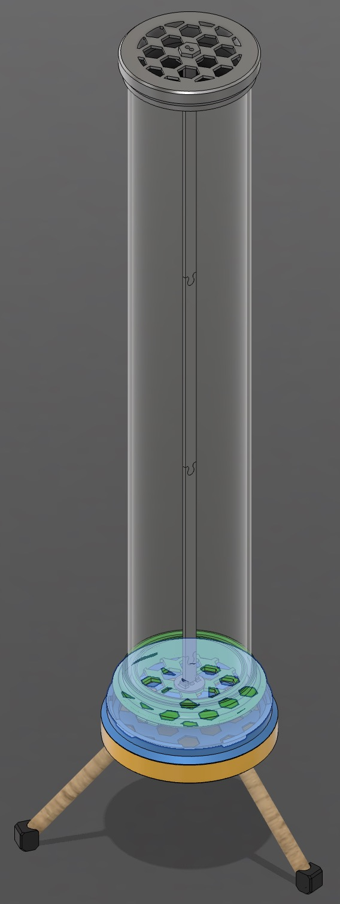
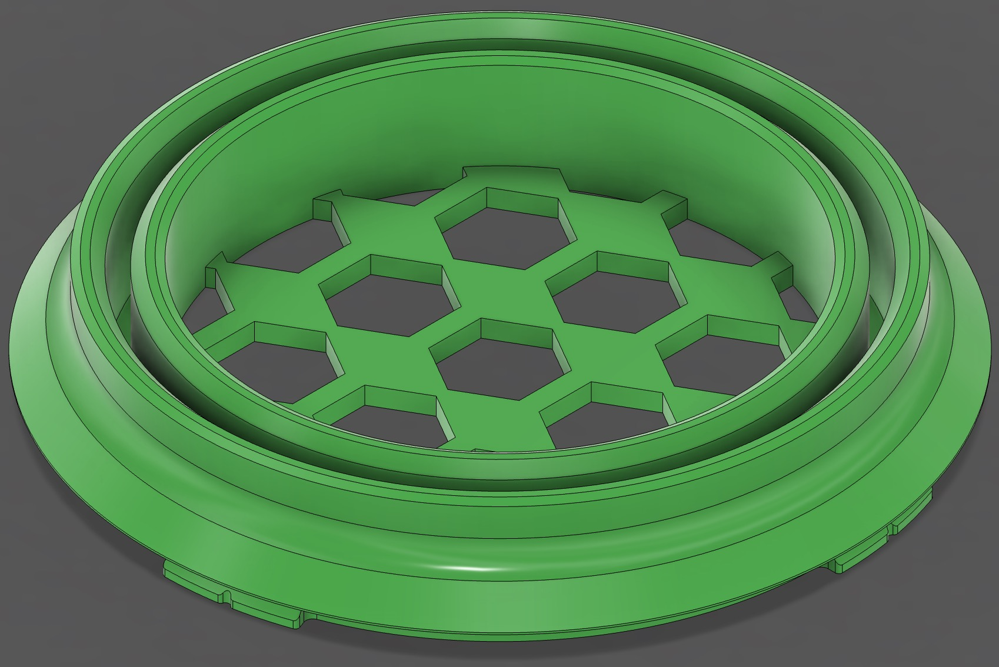
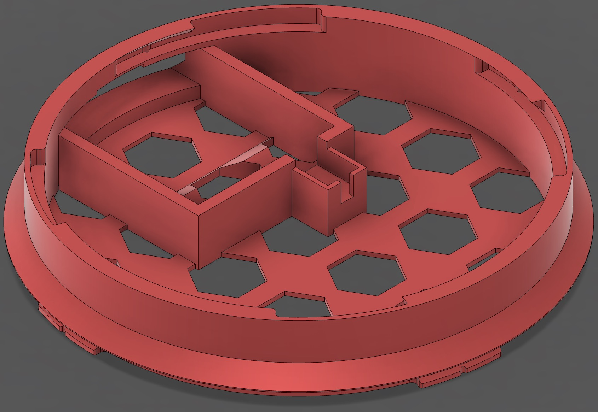
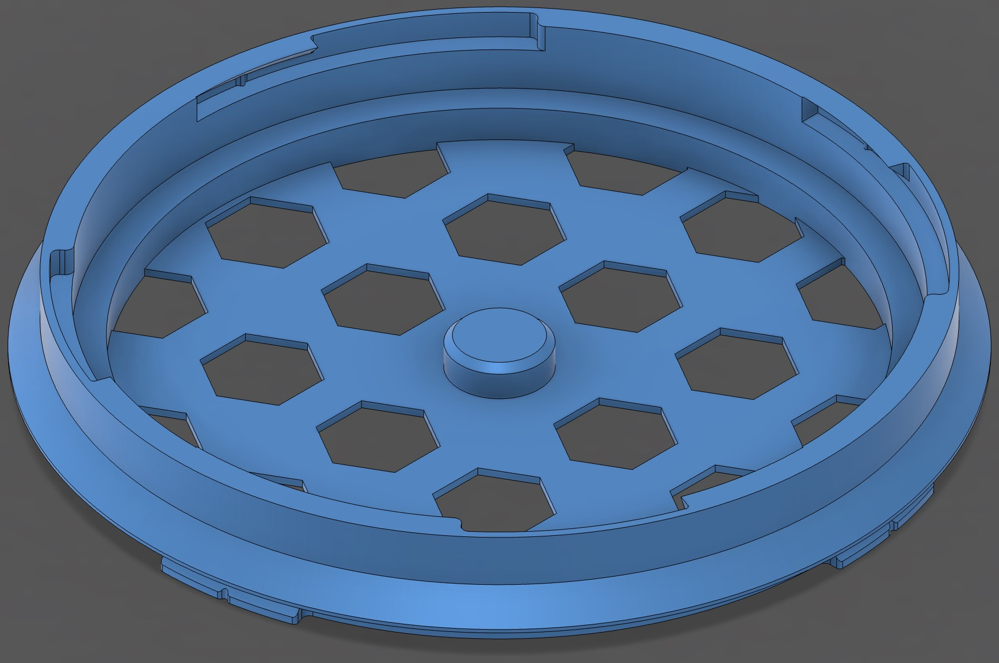
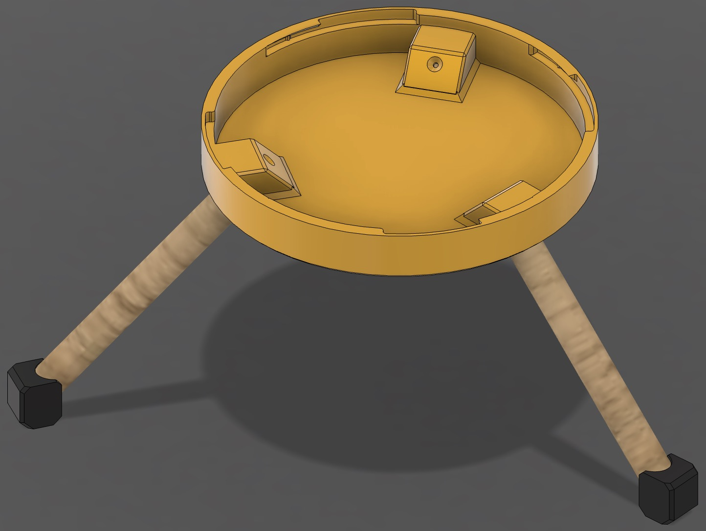

# Pics needed
## Single column
## All of them next to each other
## ESP32

# LED Columns

## 3D Printed Parts
### Foam
The foam module set the dimensions for the whole project, the diffusion tube needed to be precisely cut and glued for the 3D printed part to grip correctly. They work well "ish", but if I were to do things again, I'd have a way of locking the core in place instead of relying on friction.

### Electronics
The electronics section houses the battery and the ESP32 (which just kinda hangs loose on the cable).

One of the main goals of this project was to make connecting the power as easy as possible. I've spent enough time being annoyed by tangled cables so I wanted to develop a solution.

You can see in the top left of the image below there is a sort of square section. That's where the battery slides in, the usb connecting automatically because the plug has been glued in position before hand.

This worked really well in practice and made things so much smoother.

### Weight
I decided to use my 2kg dumbbell plates for the towers as I already had them and they're flat, making them easy to transport. I feel the weights were actually necessary to prevent the tower from falling over when knocked

### Base
The base was quite simple. Its got a spot for 3 wooden dowels to act as legs, which each have a TPU foot.

