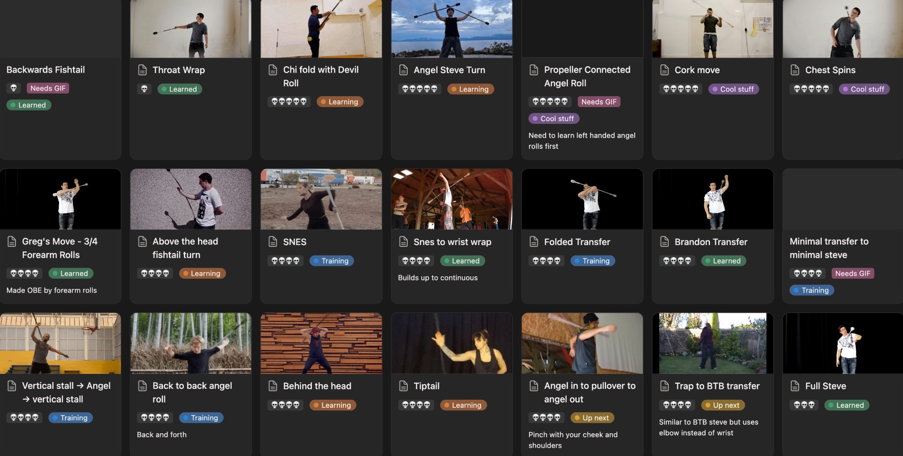
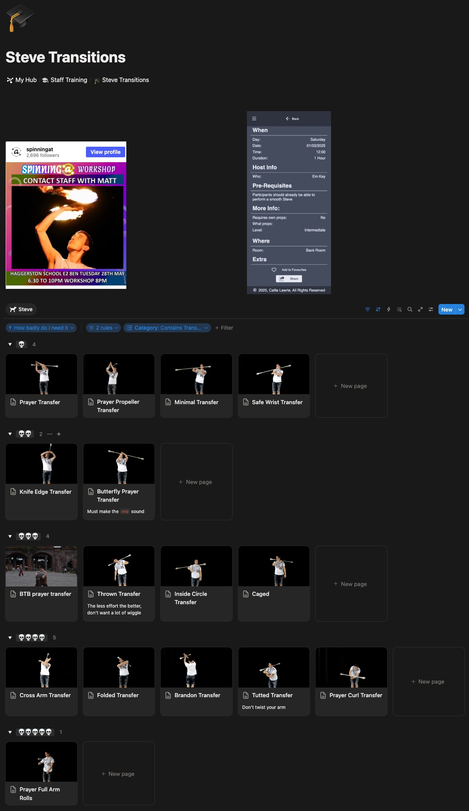

One of my main hobbies is "Contact Staff", which is a "circus skill" also considered a flow art. I have a few clips here on my [instagram](https://www.instagram.com/em.brrrr/)

There's lots of great learning resources online with an active community posting videos and tutorials regularly and I needed a place to store it all (that wasn't just a giant bookmark folder). I also wanted a way to categorize everything and make training plans for myself so I created a database in [Notion](https://www.notion.com/).

This thing has kinda gotten out of hand and now has around 150 entries.

I've had a project brewing for years to recreate the whole thing by building an actual website for it instead of in my notion but then I'd have to re record all the clips of other people and that's going to be a lot of work, maybe one day though.

Because everything is categorized it's super easy to create specific lesson plans which I'll then use when I teach. I have a few specific things I like to teach ranging from absolute beginner, never touched a staff before, to more advanced moves.

<!-- There is an link you can use that was created when I started to make it more user friendly but work stopped when I realised I probably shouldn't be sharing other peoples videos without asking them -->