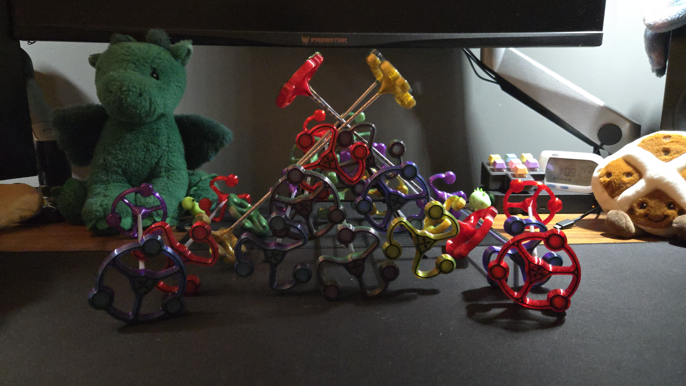
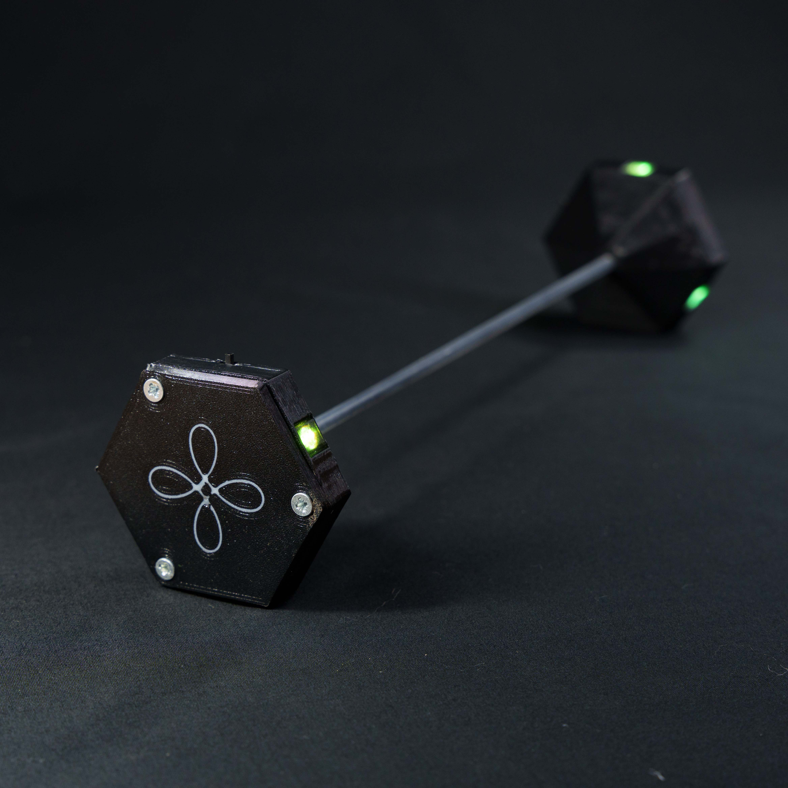
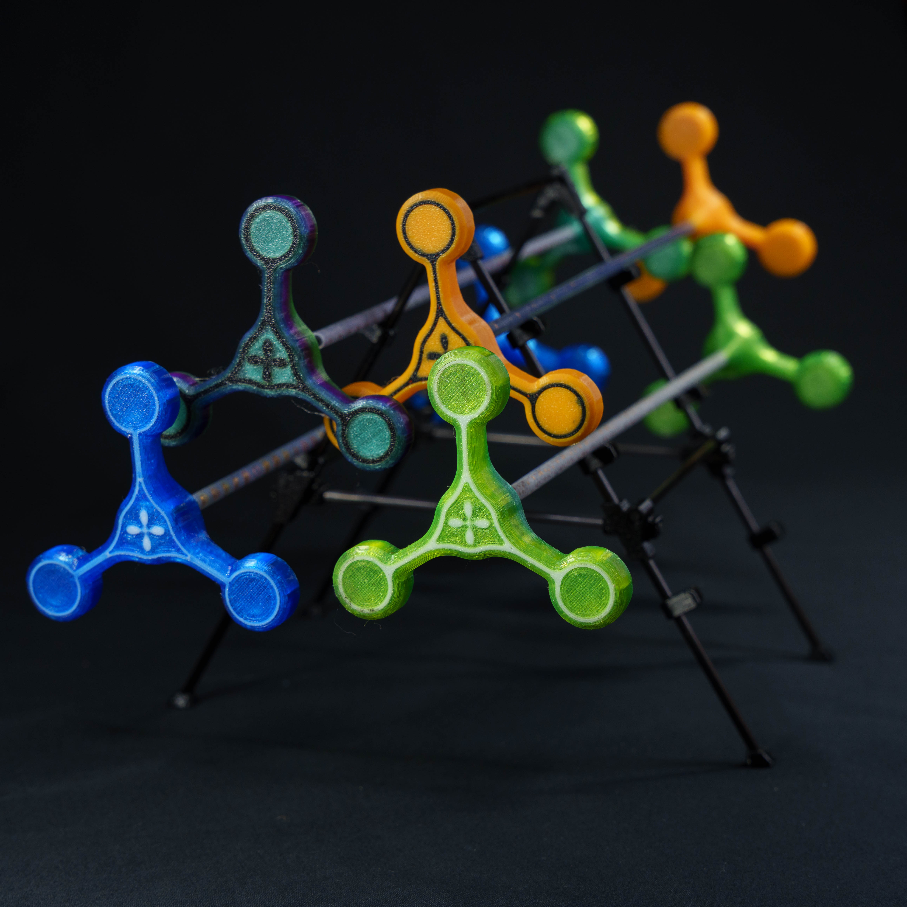
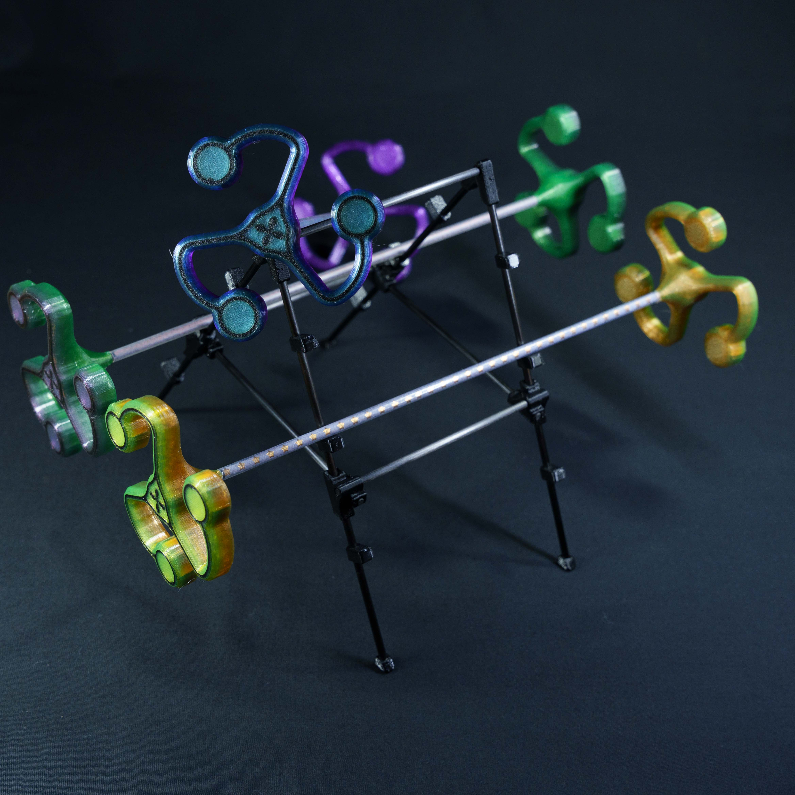

Twiddles are my most polished product by far, they've had many iterations over the years and I'm very happy with the current versions. I  have lots of variations & sell them on my [etsy store](https://www.etsy.com/shop/EmBrrrr) and in person.
My favourite is the LED version because I love all things LED and its small enough to take anywhere.

They were supposed to be a fidget prop / something to do with your hands when hanging out in a park and were based of something similar which I couldn't find online so I had a go at making my own. The main differences being a thinner grip and the overall weight being slightly heavier which makes the roll slower than other types. Peoples preference seems to follow the marmite rule (love or hate it).

When I had finalised my design, a surprising amount of people asked to buy one so now I take a bunch with me when I go to festivals.

