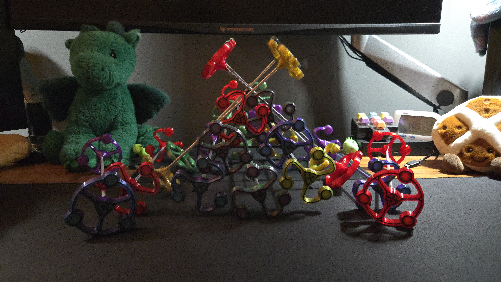
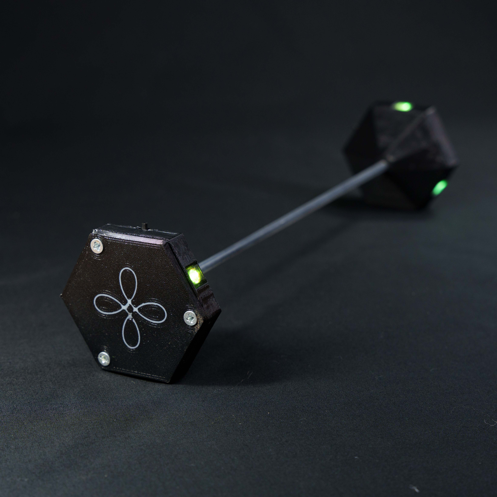
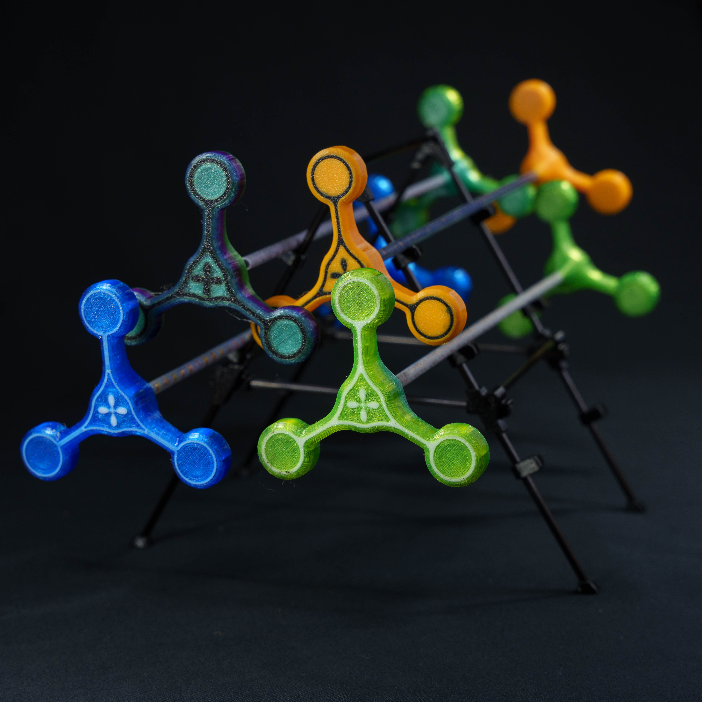
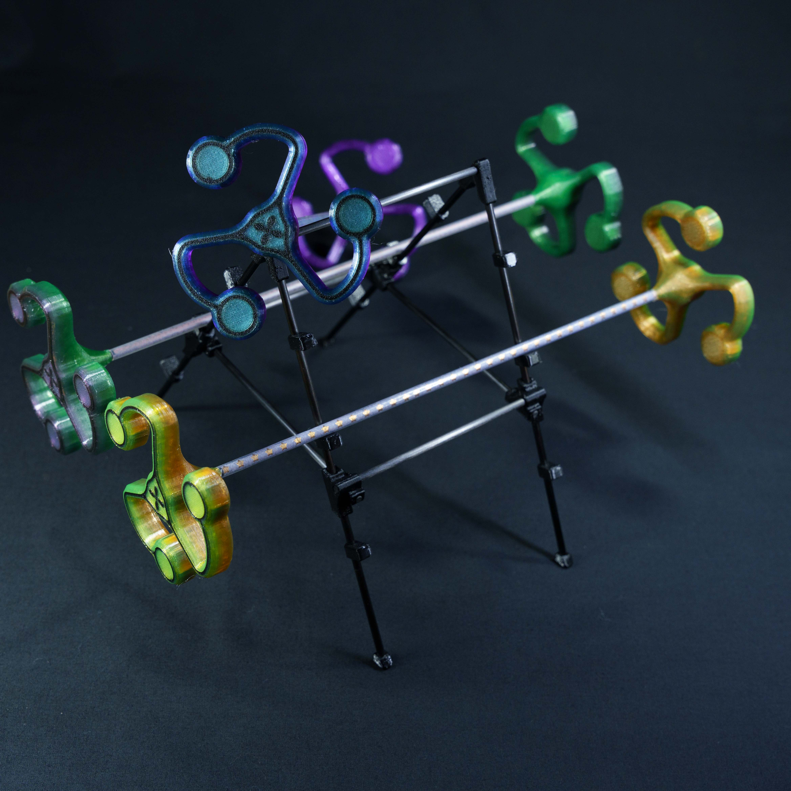

Twiddles are one of my most made things these days. They were supposed to be a fidget prop / something to do with your hands when hanging out in a park. They were based of something similar which I couldnt find online so I had a go at making my own. The main differences being a thnner grip and the overall weight being slightly heavier.
When I had finilised my design, a suprising amount of people asked to buy one so now I take a bunch with me when I go to circus festivals. I also sell them on my [etsy store](https://www.etsy.com/shop/EmBrrrr)

Below are some of the variations I make.

